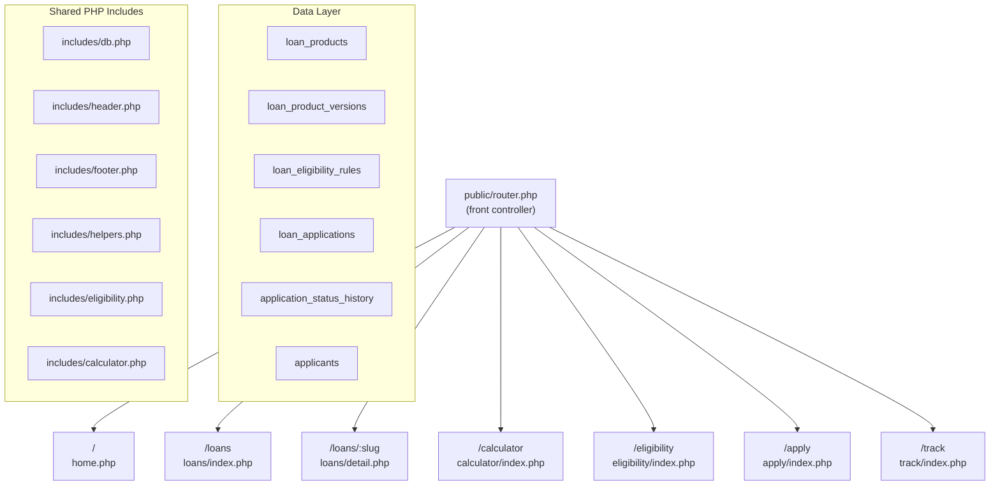

# Bank Melli Loan Platform — Phased Implementation Plan

## Existing Stack (preserved)
- PHP 8+ with strict types, no Composer
- MySQL via PDO (`includes/db.php`, `config/database.php`)
- Tailwind v4 CLI (`src/css/input.css` → `public/assets/css/app.css`)
- Front controller: `public/router.php` → `public/index.php`
- Shared layout: `includes/header.php`, `includes/footer.php`

---

## Architecture Overview



---

## Phase 1 — Foundation & Data Layer

**Goal:** Replace the generic schema and single-page setup with a multi-page router and Bank Melli-specific data structures.

### 1.1 Router (`public/router.php`)

Extend the existing front controller to dispatch to per-page PHP files:

```
/ → pages/home.php
/loans → pages/loans/index.php
/loans/mehrabani-melli → pages/loans/detail.php?slug=mehrabani-melli
/loans/etebar-melli → pages/loans/detail.php
/loans/ezdevaj → pages/loans/detail.php
/loans/farzand-avi → pages/loans/detail.php
/calculator → pages/calculator/index.php
/eligibility → pages/eligibility/index.php
/apply → pages/apply/index.php
/track → pages/track/index.php
/faq → pages/faq.php
```

All pages live under `pages/` (new directory). `router.php` uses `parse_url` + a static route map array.

### 1.2 Database Schema (`sql/schema.sql` — full replacement)

New tables replacing the generic ones:

```sql
-- Loan products (one row per product slug)
loan_products: id, slug, title_fa, description_fa, product_type
               (qard_hasanah | financing | external_government),
               application_type (direct | external),
               is_active, created_at

-- Versioned conditions (one row per version per product)
loan_product_versions: id, loan_product_id, version, max_amount, min_amount,
                       fee_options JSON, interest_rates JSON,
                       term_months_min, term_months_max, term_options JSON,
                       eligibility_notes_fa TEXT,
                       source_url, source_label_fa, last_updated_at,
                       effective_from, is_current, created_at

-- Eligibility rules (configurable, per product)
loan_eligibility_rules: id, loan_product_id, rule_key, rule_value JSON,
                        label_fa, description_fa

-- Applicants
applicants: id, full_name, national_id, mobile, birth_date, employment_type,
            monthly_income, bank_melli_account, account_activity_months,
            average_balance, created_at

-- Applications
loan_applications: id, tracking_number (MEL-XXXXXX), applicant_id,
                   loan_product_id, loan_product_version_id,
                   requested_amount, repayment_months,
                   eligibility_result (eligible|potentially|not_eligible|external),
                   status ENUM(submitted|under_review|needs_info|approved|rejected|external),
                   notes, submitted_at, created_at, updated_at

-- Status history
application_status_history: id, loan_application_id, from_status, to_status,
                             note, created_at
```

### 1.3 Seed Data (`sql/seed.sql` — new file)

Insert all four Bank Melli products with their current conditions and `last_updated_at`:

- `mehrabani-melli` — Qard al-Hasanah, direct, max 300M, fee 0/2/4%, 6–60 months
- `etebar-melli` — financing, direct, max 700M, rates 14/18/23%, 12–60 months
- `ezdevaj` — external_government, external application
- `farzand-avi` — external_government, external application

### 1.4 Shared PHP Helpers (`includes/helpers.php` — new file)

- `format_toman(int $amount): string` — e.g. "۳۰۰ میلیون تومان"
- `generate_tracking_number(): string` — `MEL-` + 6 random digits
- `get_current_version(string $slug): array` — fetch active version from DB
- `get_product_by_slug(string $slug): array`
- `fa_number(string $n): string` — convert Arabic/Latin digits to Persian

---

## Phase 2 — Loan Pages

**Files to create:**
- [`pages/home.php`](pages/home.php) — Bank Melli-focused homepage
- [`pages/loans/index.php`](pages/loans/index.php) — filterable loan listing
- [`pages/loans/detail.php`](pages/loans/detail.php) — per-product detail page

### 2.1 Homepage

Replaces [`public/index.php`](public/index.php).

- Hero: **وام مناسب بانک ملی را پیدا کنید** + primary CTA
- 4 featured product cards sourced from DB
- Each card shows max amount + "آخرین به‌روزرسانی" date
- "نحوه کار" 3-step section
- Trust signals strip (security, transparency, fast review)
- Quick loan finder widget (embedded mini-form linking to `/eligibility`)

### 2.2 Loan Listing (`/loans`)

- Filter bar: loan type, max amount range, repayment period, fee/rate, direct vs external
- Cards for all 4 products with compare checkbox
- "مقایسه" button → `/compare` (Phase 2 extension, simple table)

### 2.3 Loan Detail (`/loans/:slug`)

Sections per product:
- Hero with title, type badge, last updated date + source link
- Financial summary table (amount, rate/fee, term, estimated installment)
- Eligibility criteria list
- Application method banner — clearly labeled **"درخواست از طریق این سامانه"** or **"درخواست از سامانه رسمی"**
- CTA: for direct → `/apply?product=slug`; for external → official URL + instructions
- Disclaimer: "این برآورد بر اساس شرایط اعلام‌شده است..."

---

## Phase 3 — Calculators

**File:** [`pages/calculator/index.php`](pages/calculator/index.php)  
**Engine:** [`includes/calculator.php`](includes/calculator.php) (new)

### 3.1 مهربانی ملی Calculator

Inputs:
- Average balance (slider + input)
- Account activity period (dropdown: 6/12/18/24+ months)
- Requested amount
- Repayment period (6–60 months slider)
- Fee option (0% / 2% / 4%)

Outputs (live JS, PHP fallback via POST):
- Estimated eligible amount
- Monthly installment
- Total repayment
- Required account activity note

### 3.2 اعتبار ملی Calculator

Inputs:
- Average balance
- Account activity period
- Requested amount
- Interest rate (14% / 18% / 23% — radio)
- Repayment period (12 / 24 / 36 / 48 / 60 months — radio)

Outputs:
- Estimated eligible amount
- Monthly installment (reducing-balance formula)
- Total interest
- Total repayment

### 3.3 General Installment Calculator

Simple: amount + rate + months → installment. Always shown as tab on calculator page.

**Calculator logic** (`includes/calculator.php`):

```php
// Qard al-Hasanah: flat fee, equal principal installments
function mehrabani_installment(float $amount, float $fee_pct, int $months): array

// Reducing-balance (equated monthly installment):
function etebar_installment(float $amount, float $annual_rate_pct, int $months): array
```

Disclaimer rendered on every calculator output:
> این محاسبه صرفاً برآورد اولیه است. مبلغ نهایی توسط بانک ملی تعیین می‌شود.

---

## Phase 4 — Eligibility Engine

**File:** [`pages/eligibility/index.php`](pages/eligibility/index.php)  
**Engine:** [`includes/eligibility.php`](includes/eligibility.php) (new)

### 4.1 Loan Finder Wizard (multi-step form)

Step 1: Purpose + amount needed  
Step 2: Bank Melli account status + activity months + average balance  
Step 3: Repayment preference + guarantor availability  
Step 4: Applicant type (individual / legal entity) — for اعتبار ملی

### 4.2 Eligibility Engine Logic

Rules loaded from `loan_eligibility_rules` table. Engine returns:

```php
function evaluate_eligibility(array $inputs, string $product_slug): array {
    // Returns: result (eligible|potentially_eligible|not_eligible|external),
    //          matched_products[], explanation_fa, recommended_product
}
```

Routing logic:
- Purpose = marriage/childbirth → result `external`, redirect to `/loans/ezdevaj` or `/loans/farzand-avi`
- No Bank Melli account → explain requirement, still show products
- Low average balance → `potentially_eligible` with explanation
- Meets criteria → `eligible`, show recommended product + CTA

### 4.3 Result Page

```
Eligible → "شما احتمالاً واجد شرایط هستید" + product card + Apply CTA
Potentially → explanation of what is needed + product card
Not Eligible → explanation + suggestion
External → loan info card + official application CTA
```

---

## Phase 5 — Application Flow

**Files:** [`pages/apply/index.php`](pages/apply/index.php), [`pages/apply/review.php`](pages/apply/review.php), [`pages/apply/confirm.php`](pages/apply/confirm.php)

**Available for:** `mehrabani-melli`, `etebar-melli` only (direct application type).

### 5.1 Applicant Information Form

Single-page form (no login/registration):

```
Full name | National ID | Mobile | Date of birth
Employment type | Monthly income
Bank Melli account number | Account activity months | Average balance
Requested amount | Repayment period
(For اعتبار ملی: applicant type, interest rate preference)
```

PHP server-side validation on POST. All fields sanitized via `htmlspecialchars`.

### 5.2 Review Step

Show all submitted data in a read-only card. "ویرایش" link to go back. "ثبت نهایی" button.

### 5.3 Submit & Tracking Number

On confirm POST:
1. Insert `applicants` row (or match existing by national_id)
2. Insert `loan_applications` row with `generate_tracking_number()`
3. Insert `application_status_history` row (status: `submitted`)
4. Show confirmation:

```
درخواست شما با موفقیت ثبت شد.
کد پیگیری: MEL-839421
```

Store tracking number in session for UX continuity. No email/SMS in MVP.

---

## Phase 6 — Application Tracking

**File:** [`pages/track/index.php`](pages/track/index.php)

Public lookup: tracking number + mobile number.

Query: `loan_applications JOIN applicants WHERE tracking_number = ? AND mobile = ?`

Display:
- Application number
- Loan product name
- Requested amount
- Current status (Persian label)
- Status timeline from `application_status_history`
- For `external` status: instructions for official channel

Status labels:
```
submitted → ثبت شده
under_review → در حال بررسی
needs_info → نیاز به اطلاعات بیشتر
approved → تأیید شده
rejected → رد شده
external → درخواست از سامانه رسمی
```

---

## Phase 7 — Production Hardening

- Input validation: national ID check digit (mod-11 algorithm in PHP)
- Rate limiting: track IP in `rate_limit` table, block >10 submissions/hour
- CSRF token on all POST forms (`$_SESSION['csrf_token']`)
- Prepared statements already enforced by PDO (no raw queries)
- Error pages: custom 404 and 500 PHP pages
- Logging: `error_log()` to file, structured format
- Performance: add MySQL indexes on `tracking_number`, `national_id`, `mobile`
- `Content-Security-Policy`, `X-Frame-Options`, `X-Content-Type-Options` headers in `router.php`

---

## File Structure After All Phases

```
loan-registrarer/
├── config/database.php
├── includes/
│   ├── db.php          (existing, unchanged)
│   ├── header.php      (updated: Bank Melli branding)
│   ├── footer.php      (updated)
│   ├── helpers.php     (new)
│   ├── calculator.php  (new — Phase 3)
│   └── eligibility.php (new — Phase 4)
├── pages/
│   ├── home.php
│   ├── faq.php
│   ├── loans/
│   │   ├── index.php
│   │   └── detail.php
│   ├── calculator/
│   │   └── index.php
│   ├── eligibility/
│   │   └── index.php
│   ├── apply/
│   │   ├── index.php
│   │   ├── review.php
│   │   └── confirm.php
│   └── track/
│       └── index.php
├── public/
│   ├── router.php      (extended — Phase 1)
│   ├── index.php       (becomes thin dispatcher)
│   └── assets/
│       ├── css/app.css
│       └── js/app.js   (extended with calculator JS — Phase 3)
├── sql/
│   ├── schema.sql      (replaced — Phase 1)
│   └── seed.sql        (new — Phase 1)
└── src/css/input.css   (extended with new component classes)
```

---

## Key Design Decisions

- **No new dependencies** — stay with plain PHP 8 + PDO + Tailwind v4 CLI
- **Versioned loan data** — `loan_product_versions` with `last_updated_at` and `source_url`; homepage always shows "آخرین به‌روزرسانی" date
- **Direct vs External** — `application_type` column on `loan_products` controls which flow is shown; no fake Bank Melli submission for marriage/childbirth
- **Calculator JS** — live calculation via vanilla JS in `app.js`; PHP POST fallback for no-JS
- **No sessions required for tracking** — tracking lookup is public (tracking number + mobile)
- **Session used only for CSRF** — `session_start()` in router, no login state
