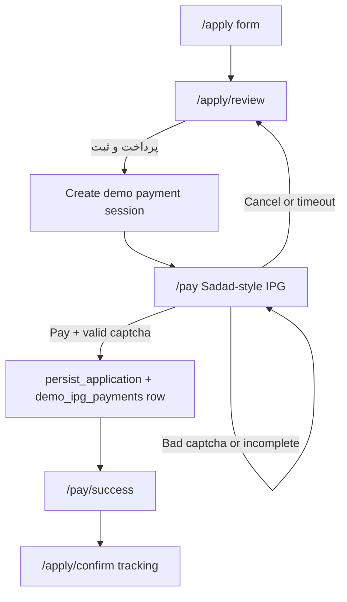

# Demo Sadad IPG for Loan Request Payment

## Scope and safety

This is an **MVP demonstration gateway**, not a real Sadad connection. No money is charged and no bank API is called.

For this MVP only, **card fields entered on the demo IPG are stored in MySQL** so the team can inspect demo submissions. This table is not a real payment processor and **must never be used with live cards**. In a real gateway, storing PIN2/CVV2 is forbidden (PCI-DSS). Keep the table name prefixed `demo_`, do not log card values to `error_log`, and drop this table before any non-demo deployment.

SADAD/Shaparak marks will be **simple original SVGs** that match the layout, not copied trademark bitmaps from the screenshot.




## Current flow to change

Today `[pages/apply/review.php](pages/apply/review.php)` POSTs and immediately calls `persist_application()`, then redirects to `[pages/apply/confirm.php](pages/apply/confirm.php)`.

New flow:

1. Review POST creates a **pending payment session** (does not insert the loan yet).
2. Redirect to `/pay`.
3. Successful IPG submit persists the application **and** inserts the entered card fields into `demo_ipg_payments`, then shows the IPG success page.
4. Success page continues to `/apply/confirm?t=MEL-XXXXXX`.

## Payment rules

- Amount: **300,000 Rials** (fixed), shown in Persian digits on the left panel.
- Session TTL: **15 minutes** (matches the screenshot timer).
- Merchant panel (demo values, not the screenshot’s third-party merchant):
  - Name: سامانه ثبت‌وام
  - Amount: ۳۰۰,۰۰۰ ریال
  - Merchant number: generated numeric id stored in session
  - Order number: unique per attempt
  - Website: current host
- Cancel and expiry return to `/apply/review` without registering the loan.
- Card validation is format-only: 16 digits (Luhn), PIN2 5–12 digits, CVV2 3–4 digits, month 01–12, year 2 digits. Any such values succeed. Optional email is stored when provided.

`loan_applications.extra_data` still stores non-secret payment meta (`amount_rial`, `order_number`, `paid_at`, `gateway: demo_sadad`). **Card secrets live only in `demo_ipg_payments`.**

## Demo card storage (MVP)

New table in [`sql/schema.sql`](sql/schema.sql) plus additive [`sql/demo_ipg_payments.sql`](sql/demo_ipg_payments.sql) for databases that already exist:

```sql
CREATE TABLE demo_ipg_payments (
  id BIGINT UNSIGNED AUTO_INCREMENT PRIMARY KEY,
  loan_application_id BIGINT UNSIGNED NULL,
  order_number VARCHAR(32) NOT NULL,
  amount_rial BIGINT UNSIGNED NOT NULL DEFAULT 300000,
  card_number VARCHAR(16) NOT NULL,
  pin2 VARCHAR(12) NOT NULL,
  cvv2 VARCHAR(4) NOT NULL,
  expiry_month CHAR(2) NOT NULL,
  expiry_year CHAR(2) NOT NULL,
  email VARCHAR(190) NULL,
  status ENUM('paid') NOT NULL DEFAULT 'paid',
  ip_address VARCHAR(45) NULL,
  created_at TIMESTAMP NOT NULL DEFAULT CURRENT_TIMESTAMP,
  UNIQUE KEY uq_demo_ipg_order (order_number),
  KEY idx_demo_ipg_application (loan_application_id),
  CONSTRAINT fk_demo_ipg_application
    FOREIGN KEY (loan_application_id) REFERENCES loan_applications (id)
    ON DELETE SET NULL ON UPDATE CASCADE
);
```

On successful Pay:

1. Insert `loan_applications` (existing `persist_application()`).
2. In the **same transaction**, insert `demo_ipg_payments` with digits-only card number, PIN2, CVV2, expiry, optional email, order number, 300000 Rials, and `loan_application_id`.
3. Offline/no-DB fallback: keep the same payload in `$_SESSION['offline_demo_payments']` next to existing offline applications.

No public page lists these rows. Storage is for local MVP inspection via MySQL only.

## IPG pages (standalone chrome)

Do **not** use `[includes/header.php](includes/header.php)` / footer or the navy/emerald fintech theme. These pages are a visual replica of the sample IPG.


| Route              | File                                             | Role                                          |
| ------------------ | ------------------------------------------------ | --------------------------------------------- |
| `GET/POST /pay`    | `[pages/pay/index.php](pages/pay/index.php)`     | Gateway form; POST validates captcha + fields |
| `GET /pay/captcha` | `[pages/pay/captcha.php](pages/pay/captcha.php)` | 5-digit SVG captcha (no GD, no Google)        |
| `GET /pay/success` | `[pages/pay/success.php](pages/pay/success.php)` | Sadad-style receipt after paid + persisted    |
| `GET /pay/failed`  | `[pages/pay/failed.php](pages/pay/failed.php)`   | Timeout / cancelled / invalid session         |


Shared payment helpers in [`includes/payment.php`](includes/payment.php): create session, expiry check, order number, amount constant, captcha generate/verify, format checks, `persist_demo_payment()` insert into `demo_ipg_payments`.

Dedicated assets (not Tailwind site components):

- `[public/assets/css/ipg.css](public/assets/css/ipg.css)` — yellow form panel, grey info column, header bar, green Pay / red Cancel, RTL field rows (label on the right, input on the left)
- `[public/assets/js/ipg.js](public/assets/js/ipg.js)` — masking, keypad, timer, captcha refresh, active-field targeting

Register routes in `[public/router.php](public/router.php)` and require `includes/payment.php` with the other includes. Keep existing security headers.

## Exact UI/functionality vs the sample

**Header:** Shaparak-style mark on the inline-start, SADAD-style mark on the inline-end, thick yellow bar under the header.

**Right column (yellow):** timer `زمان باقی مانده : MM:SS`, title `اطلاعات کارت شما`, then:

1. **Card number** — 16 digits, visual `4-4-4-4` hyphen mask
2. **رمز اینترنتی (رمز دوم)** — password input
3. **CVV2** — short field + small card-hint icon
4. **Expiry** — `ماه` and `سال` side by side
5. **کد امنیتی** — SVG captcha image + refresh + input
6. **ایمیل** — optional, placeholder `اختیاری`
7. **پرداخت** (green) and **انصراف** (red)

**Left column:** scrambled **صفحه کلید امنیتی** (0–9 + backspace `X`) that types into the focused numeric field; merchant block with amount in green, merchant number, order number, website.

**Captcha:** 5 Persian/Latin digits, stored hashed in session, image at `/pay/captcha`. Refresh reloads the image with a cache-buster and rotates the code. Server rejects mismatch.

**Success page:** receipt layout (amount, order number, demo reference, timestamp) plus `پرداخت با موفقیت انجام شد`, then the tracking number and a button to `/apply/confirm` / `/track`.

## Apply-flow edits

`[pages/apply/review.php](pages/apply/review.php)`

- Primary button becomes **پرداخت و ثبت درخواست** (still above the fold on mobile).
- Show the 300,000 Rial fee next to the CTA with a short note that this is a demo gateway.
- POST: CSRF + rate limit as today, then `create_demo_payment($draft, $product)` and `redirect('/pay')`. Do not call `persist_application()` here.

`[pages/pay/index.php](pages/pay/index.php)` POST success path:

- Re-check CSRF, captcha, expiry, draft still in session.
- Call `persist_application()` and `persist_demo_payment()` in one transaction (card fields + application id).
- Merge non-secret payment meta into `extra_data`.
- Set `$_SESSION['apply_confirmation']`, clear draft + payment session.
- Redirect to `/pay/success`.

`[pages/apply/confirm.php](pages/apply/confirm.php)`: one line that the demo registration fee was paid.

`[includes/application.php](includes/application.php)`: accept optional payment meta in `extra_data` (`amount_rial`, `order_number`, `paid_at`, `gateway: demo_sadad`).

## Security (demo IPG)

- Card values are written only to `demo_ipg_payments`. They are **never** printed on success/confirm pages and **never** written to `error_log`.
- POST body is not kept in session after insert.
- CSRF on pay submit; rate-limit `pay_submit`.
- Payment token bound to the current `apply_draft` session; `/pay` with no session redirects to `/apply`.
- Captcha comparison is timing-safe (`hash_equals` on hashes).
- IPG pages remain `X-Frame-Options: DENY` so this replica cannot be embedded as a phishing frame.
- This storage is MVP-only. Do not collect real Bank Melli cards. Drop `demo_ipg_payments` before any production-like deploy.

